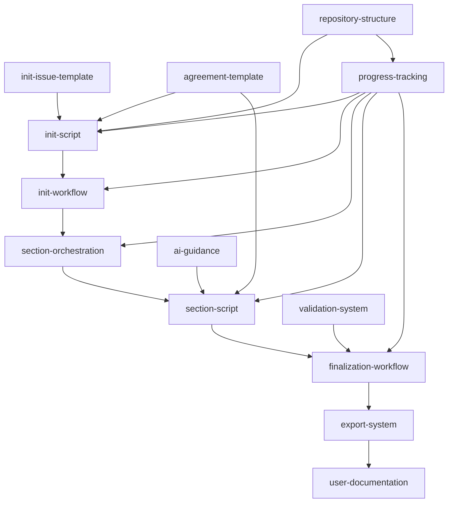

# Implementation Plan: Blueprint

**Spec**: [Blueprint spec](./spec.md)

---

## Summary

This plan realizes the functional requirements in [spec.md](./spec.md) by breaking the product into 13 discrete, implementable features with clear dependencies, complexity estimates, and implementation priorities. It documents the feature dependency graph, the full feature catalog, and the recommended build order — serving as the architectural roadmap for implementing the Catalyst Founders Agreement product.

**Design rationale**: See [research.md](./research.md) for detailed feature breakdown analysis, dependency tier structure, and architectural alignment decisions.

---

## Technical Context

This feature implementation plan extends the technical architecture defined in [.xe/architecture.md](../../architecture.md).

**Feature-specific technical details:**

- **Primary Components**: 13 features spanning repository setup, configuration intake, agreement templating, automation workflows, section processing, validation, and finalization
- **Data Structures**: Feature metadata (ID, dependencies, complexity, priority, scope), dependency graph (mermaid format)
- **Dependencies**: Product vision (.xe/product.md), architecture guidelines (.xe/architecture.md), engineering principles (.xe/engineering.md)
- **Configuration**: None (this feature produces specification only)
- **Performance Goals**: N/A (documentation feature)
- **Testing Framework**: Manual validation of spec completeness and dependency graph correctness
- **Key Constraints**: Dependency graph MUST be acyclic, all features MUST have unique IDs

---

## Feature Dependency Graph

The graph visualizes relationships between all features across 5 tiers:

- **Tier 0**: Foundation (no dependencies)
- **Tier 1**: Core Configuration (depend on Tier 0)
- **Tier 2**: Automation (depend on Tier 1)
- **Tier 3**: Section Processing (depend on Tier 2)
- **Tier 4**: Finalization (depend on Tier 3)

---

## Feature Catalog

### Tier 0: Foundation (No Dependencies)

#### Feature 1: repository-structure

**ID**: `repository-structure`
**Dependencies**: None
**Complexity**: Medium
**Priority**: 1

**Scope**: Define and create base configuration files, GitHub repository settings, and labels required by all other features. Folders are created by features that own the files within them.

**Deliverables**:

1. **Base Configuration Files**:
   - `package.json` - Node.js project configuration with dependencies
   - `tsconfig.json` - TypeScript configuration
   - `jest.config.js` - Test configuration
   - `.gitignore` - Git ignore rules
   - `README.md` - Repository overview

2. **GitHub Repository Configuration**:
   - Enable template repository flag
   - Configure branch protection for main branch
   - Set up required status checks

3. **GitHub Labels**:
   - Create labels for issue categorization and workflow automation
   - Labels will support section tracking and status management

#### Feature 2: init-issue-template

**ID**: `init-issue-template`
**Dependencies**: None
**Complexity**: Medium
**Priority**: 2

**Scope**: Create GitHub issue form template with 8 configuration questions, each with dropdown options and clear descriptions. Template includes explicit instructions for AI on how to process responses and which script to execute.

**Questions**: Each question includes dropdown options and explicit handling logic for each choice. "Undecided" always means "no default applied" and is left for manual or AI-assisted discussion later.

| # | Category | Question | Options | Default Behavior |
|---|-----------|-----------|----------|------------------|
| 1 | **Funding Intent** | Are you planning to raise outside capital (investors, accelerators, or studios) in the next 12 months? | **Yes** → Apply *Venture-style* defaults: 4-year vesting, 1-year cliff, 10–15% option pool, board governance, investor consent rights. **No** → Apply *Bootstrapped-style* defaults: simple majority governance, equal or weighted equity, optional vesting. **Undecided** → Skip funding-related defaults. |
| 2 | **Contribution Balance** | Are founders contributing roughly equally in time, IP, and capital? | **Yes** → Use *Equal Split (Bootstrapped 50/50)* model. **No** → Use *Weighted IP/Capital* model with explicit ownership ratios. **Undecided** → Skip equity-split default. |
| 3 | **Time Commitment** | Are all founders full-time, or do some plan to go full-time later? | **All full-time** → Standard vesting commencement immediately. **Some part-time** → Apply *Part-Time→Full-Time Ramp* defaults: vesting starts at full-time transition, rebalancing checkpoint. **Undecided** → Leave vesting timing unset. |
| 4 | **Equity Flexibility** | Do you want ownership to automatically adjust based on ongoing contributions? | **Yes** → Apply *Dynamic (Slicing Pie)* model; enable ongoing contribution tracking. **No** → Fixed split with standard vesting. **Undecided** → Skip equity-model default. |
| 5 | **Studio Involvement** | Are you building this under a startup studio, accelerator, or parent company providing capital or infrastructure? | **Yes** → Apply *Studio/Foundry* defaults: studio equity 30–60%, board control until seed, inbound IP license. **No** → Skip studio-specific defaults. **Undecided** → Skip. |
| 6 | **Open Source Focus** | Is the product open-source or dependent on a public codebase? | **Yes** → Apply *Open-Source Core* defaults: IP assignment to company, dual licensing, CLA requirement. **No** → Skip licensing defaults. **Undecided** → Skip. |
| 7 | **Investment Avoidance** | Are you intentionally avoiding external investors and focusing on revenue or profit first? | **Yes** → Apply *Indie Revenue-Share* defaults: no vesting, equal or light-weight equity, quarterly profit distributions. **No** → Keep normal vesting/governance defaults. **Undecided** → Skip. |
| 8 | **Team Size** | Are there more than three founders? | **Yes** → Apply *Venture-Track* governance defaults: role-weighted equity, formal board, reserved matters list. **No** → Apply simplified two-founder governance defaults. **Undecided** → Skip. |

#### Feature 3: agreement-template

**ID**: `agreement-template`
**Dependencies**: None
**Complexity**: Large
**Priority**: 3

**Scope**: Complete agreement template system including markdown document structure, configuration guide documentation, content snippets for all option combinations, and section-specific issue templates for AI-driven completion.

**Deliverables**:

1. **Agreement Template** (`templates/agreement-template.md`):
   - Document header with metadata placeholders
   - Introduction section with purpose statement
   - 8 core section placeholders (equity, vesting, IP, governance, roles, capital, exit, dispute)
   - Signature blocks and footer

2. **Configuration Guide Documentation** (`docs/configure.md`):
   - Overview of founders agreements
   - Detailed explanation of each of 8 configuration questions
   - When to choose each option and implications of each choice
   - How options interact with each other
   - Common scenarios and recommended configurations
   - Glossary of legal and startup terms

3. **Content Snippets** (`.xe/snippets/{section}/{option}.md`):
   - Equity split models (equal, weighted, dynamic)
   - Vesting schedules (standard, custom, none)
   - IP assignment clauses
   - Governance structures (simple majority, board-based, role-weighted)
   - Capital contribution terms
   - Exit and buyout provisions
   - Non-compete and non-solicitation clauses
   - Dispute resolution mechanisms
   - Coverage for all meaningful combinations of 8 configuration questions

4. **Section Issue Templates** (`.github/ISSUE_TEMPLATE/sections/`):
   - One template per agreement section (8 templates)
   - Section context and configuration references
   - Explicit script execution instructions for AI
   - Validation requirements and acceptance criteria

**Usage**: Template is instantiated by init-script and populated by section-script with content from snippets based on startup configuration.

---

### Tier 1: Core Configuration (Depends on Tier 0)

#### Feature 4: init-script

**ID**: `init-script`
**Dependencies**: `repository-structure`, `init-issue-template`, `agreement-template`, `progress-tracking`
**Complexity**: Large
**Priority**: 4

**Scope**: TypeScript script with embedded JSON schema that processes initialization issue responses, validates inputs, generates base agreement structure from template, initializes progress tracking, saves configuration, and updates CODEOWNERS file.

**Key Requirements**:
- Define embedded JSON schema for configuration file (8 questions, founder info, metadata)
- Parse issue body and extract question responses
- Validate responses against schema
- Instantiate `founders-agreement.md` from agreement-template with section placeholders
- Call progress-tracking API to create initial `progress.md` with section checklist
- Save validated configuration
- Update `.github/CODEOWNERS` with founder information
- Create summary comment on initialization issue

**Configuration File**: Naming options to consider - `startup-settings.json`, `founder-settings.json`, `agreement-settings.json`, `agreement.json`, or `agreement.config`

#### Feature 5: progress-tracking

**ID**: `progress-tracking`
**Dependencies**: `repository-structure`
**Complexity**: Small
**Priority**: 5

**Scope**: Utility library for creating and updating `progress.md` with visual progress indicators showing which sections are complete, in progress, or not started. Consumed by init-script, section-script, and finalization-workflow.

**API Functions**:
- `createProgressFile(sections[])` - Initialize progress.md with section checklist
- `updateSectionStatus(sectionId, status)` - Mark section as complete/in-progress
- `getCompletionPercentage()` - Calculate overall progress
- `isComplete()` - Check if all sections are done
- `getSectionStatus(sectionId)` - Get current status of a section

---

### Tier 2: Automation (Depends on Tier 1)

#### Feature 6: init-workflow

**ID**: `init-workflow`
**Dependencies**: `init-script`, `progress-tracking`
**Complexity**: Large
**Priority**: 6

**Scope**: GitHub Action workflow that triggers when initialization issue is created/updated, executes init-script, and orchestrates the initialization process.

**Triggers**:
- Issue created with `init-agreement` template
- Issue updated with label `ready-for-processing`

**Steps**:
1. Validate issue has required label and assignments
2. Install dependencies (npm install)
3. Execute init-script with issue data
4. Commit generated files to new branch
5. Create PR for founder review
6. Post summary comment with next steps
7. Close initialization issue when PR merged

#### Feature 7: section-orchestration

**ID**: `section-orchestration`
**Dependencies**: `init-workflow`, `agreement-template`, `progress-tracking`
**Complexity**: Large
**Priority**: 7

**Scope**: GitHub Action workflow that detects when `founders-agreement.md` is created (post-initialization) and automatically creates section-specific issues for each agreement section using templates from agreement-template feature, assigning them to AI.

**Triggers**:
- Initialization PR is merged (creates `founders-agreement.md` in main branch)
- Only triggers once when `progress.md` shows all sections as not started

**Functionality**:
- Read agreement structure and identify sections
- For each incomplete section, create issue from section template
- Assign issue to configured AI agent (e.g., copilot-swe-agent, Claude Code)
- Add section context and configuration from settings file
- Include explicit instructions for which script to run
- Track created issues in `progress.md`

---

### Tier 3: Section Processing (Depends on Tier 2)

#### Feature 8: section-script

**ID**: `section-script`
**Dependencies**: `agreement-template`, `section-orchestration`, `progress-tracking`
**Complexity**: Large
**Priority**: 8

**Scope**: TypeScript script that reads configuration, selects appropriate snippets from agreement-template, assembles section content, and updates `founders-agreement.md` with the completed section.

**Functionality**:
- Read section ID from script arguments
- Load configuration from settings file
- Determine which snippets to use based on configuration
- Assemble section content from snippets
- Insert section content into correct location in agreement
- Update progress.md to mark section complete
- Generate PR with section changes
- Validate section completeness

**Selection Logic**:
- Map configuration profile to snippet paths
- Handle "Undecided" options (use neutral/placeholder content)
- Merge multiple snippets when required
- Apply variable substitution (founder names, dates, etc.)

#### Feature 9: ai-guidance

**ID**: `ai-guidance`
**Dependencies**: `agreement-template`
**Complexity**: Small
**Priority**: 9

**Scope**: AI instruction files that guide collaborative behavior, tone, and approach when answering founder questions about agreement options.

**Requirements**:
1. Generate minimal content in agent-specific instruction files (use Claude Code and GitHub Copilot as examples)
2. Require that common instructions are centralized in a shared file (must live in `.xe/` folder) to avoid duplication across agent-specific files

**Instruction Areas**:
- How to interpret founder questions
- When to reference configuration guide documentation
- Tone and style (collaborative, educational, non-legal-advice disclaimer)
- How to explain tradeoffs between options
- When to suggest alternatives
- How to handle ambiguous requests

#### Feature 10: validation-system

**ID**: `validation-system`
**Dependencies**: `init-script`, `section-script`
**Complexity**: Large
**Priority**: 10

**Scope**: TypeScript validation utilities that check agreement completeness, section consistency, configuration validity, and readiness for finalization.

**Validation Rules**:
- All required sections present and non-empty
- Founder information complete and consistent
- Configuration profile matches applied content
- No placeholder text remaining
- Cross-references between sections valid
- Markdown formatting correct
- All progress.md items marked complete

**Validation Triggers**:
- After each section update (section-level validation)
- Before finalization (full agreement validation)
- On-demand via script execution

---

### Tier 4: Finalization (Depends on Tier 3)

#### Feature 11: finalization-workflow

**ID**: `finalization-workflow`
**Dependencies**: `validation-system`, `section-script`, `progress-tracking`
**Complexity**: Large
**Priority**: 11

**Scope**: GitHub Action workflow that triggers when all sections are complete, runs final validation, executes export-system, creates GitHub release with ISO date version, and attaches PDF.

**Triggers**:
- All items in progress.md marked complete
- Manual workflow dispatch with "finalize" label

**Steps**:
1. Run full agreement validation
2. Execute export-system to generate PDF
3. Create git tag with ISO date (yyyy-MM-dd)
4. Create GitHub release with tag
5. Attach PDF to release as artifact
6. Update README with release link
7. Post completion notification comment
8. Archive all section issues
9. Clean up temporary files

#### Feature 12: export-system

**ID**: `export-system`
**Dependencies**: `finalization-workflow`, `validation-system`
**Complexity**: Large
**Priority**: 12

**Scope**: TypeScript script that converts `founders-agreement.md` to professional PDF format with proper styling, formatting, and legal document conventions.

**Functionality**:
- Read and parse markdown agreement
- Apply professional document styling
- Generate table of contents
- Add headers/footers with founder names and date
- Format sections with proper legal numbering
- Embed metadata (version, creation date, founders)
- Output PDF
- Validate PDF generation success

**Technical Approach**:
- Use markdown-to-pdf library (e.g., markdown-pdf, puppeteer)
- Custom CSS for legal document formatting
- Ensure reproducible, deterministic output

#### Feature 13: user-documentation

**ID**: `user-documentation`
**Dependencies**: `export-system`
**Complexity**: Medium
**Priority**: 13

**Scope**: Complete end-user product documentation covering how to use the template, customize agreements, understand workflows, and troubleshoot issues.

**Documentation Files**:
- `docs/README.md` - Overview and quick start
- `docs/workflow.md` - How the automation works
- `docs/customize.md` - How to customize snippets and templates
- `docs/troubleshoot.md` - Common issues and solutions
- `docs/faq.md` - Frequently asked questions

---

## Data Model

Not applicable

---

## Contracts

Not applicable

---

## Implementation Approach

**Recommended Feature Implementation Order**:

1. **Tier 0 (Parallel)**: repository-structure, init-issue-template, agreement-template
2. **Tier 1 (Sequential)**: progress-tracking → init-script
3. **Tier 2 (Sequential)**: init-workflow → section-orchestration
4. **Tier 3 (Parallel then convergence)**: section-script, ai-guidance, validation-system → all feed into Tier 4
5. **Tier 4 (Sequential)**: finalization-workflow → export-system

**Parallelization Opportunities**:
- All Tier 0 features can be built simultaneously (3 parallel tracks)
- Tier 3 features (section-script, ai-guidance, validation-system) can be built in parallel after Tier 2 completes
- With 2 developers: ~6-9 weeks total timeline
- With 1 developer: ~10-15 weeks total timeline

**Critical Path**: repository-structure → progress-tracking → init-script → init-workflow → section-orchestration → section-script → finalization-workflow → export-system

**Implementation Entry Point**: Each feature is implemented via `/catalyst:run start-rollout {feature-id}` which creates the spec, plan, and tasks for that feature.
