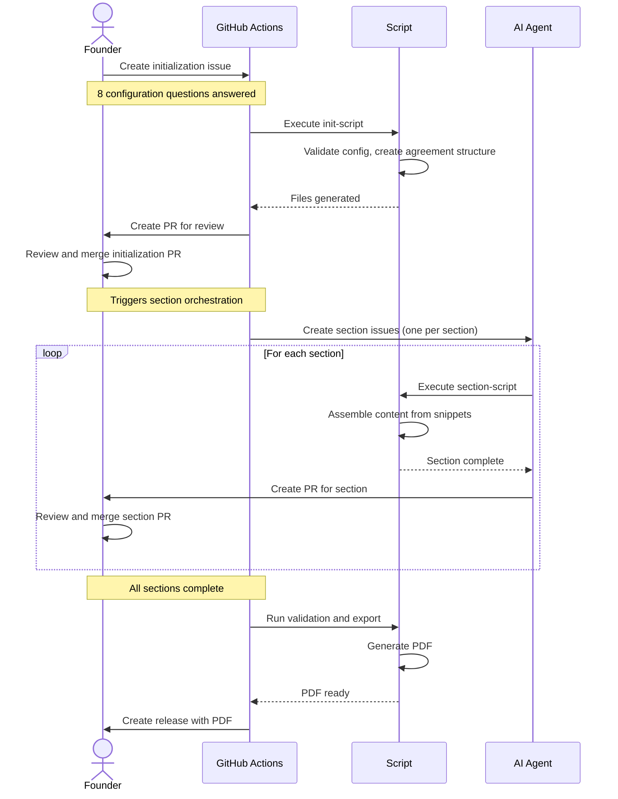

# Blueprint: Catalyst Founders Agreement

## Description

This blueprint defines the complete feature roadmap for the Catalyst Founders Agreement product—a GitHub template repository that automates the creation of structured founders agreements through AI-assisted, version-controlled collaboration.

The product transforms complex legal document creation into a guided, collaborative workflow where founders answer configuration questions, AI generates contextually appropriate content, and founders iteratively refine sections until consensus is reached. The final output is a professional PDF.

## Core Entities

**Configuration Profile**
- Startup type, funding intent, contribution balance, time commitment
- Equity flexibility, studio involvement, open source focus, investment avoidance, team size
- Stored as structured JSON, drives all downstream content generation

**Agreement Document**
- Markdown-based structured document with discrete sections
- Version-controlled with full audit trail
- Exports to PDF for legal review

**Content Snippet**
- Predefined content blocks for specific configuration combinations
- Organized by section and option
- Enables deterministic, repeatable agreement generation

**Section**
- Individual agreement component (equity split, vesting, IP assignment, governance, etc.)
- Completed independently via dedicated issue/PR workflow
- Tracks completion status

**Issue Template**
- Structured form for initialization and section completion
- Contains explicit instructions for AI execution
- Includes validation requirements

**GitHub Workflow**
- Event-driven automation for initialization, orchestration, finalization
- Triggered by issue creation, file updates, section completion
- Orchestrates multi-step processes

## Functional Requirements

- **FR1**: The system MUST allow founders to provide startup configuration through a structured set of questions (funding intent, contribution balance, time commitment, equity flexibility, studio involvement, open source focus, investment avoidance, team size), each with a bounded set of options including an explicit "undecided" state.
- **FR2**: The system MUST generate a founders agreement document structured into discrete, independently completable sections covering equity split, vesting, IP assignment, governance, roles and responsibilities, capital contributions, exit provisions, and dispute resolution.
- **FR3**: The system MUST assemble section content deterministically from the founder's configuration, selecting from predefined content options that cover all meaningful combinations of configuration choices.
- **FR4**: The system MUST track and surface completion progress for each agreement section and for the agreement as a whole.
- **FR5**: The system MUST orchestrate section completion as independent, reviewable units of work, each proposed via pull request for founder review before being merged.
- **FR6**: The system MUST validate agreement completeness and configuration consistency before the agreement can be finalized.
- **FR7**: The system MUST produce a professionally formatted, dated PDF export of the completed agreement upon finalization, and publish it as part of a versioned release.
- **FR8**: The system MUST provide AI collaboration guidance so founders can ask questions about agreement options and receive consistent, non-legal-advice-disclaimed answers; shared guidance MUST be centralized rather than duplicated per AI platform.
- **FR9**: The system MUST maintain the full agreement history under version control with a complete audit trail of changes.

## Non-Functional Requirements

- **NFR1**: Section content generation MUST be deterministic and reproducible — the same configuration input MUST always produce the same output.
- **NFR2**: The configuration question set and its defaults MUST be extensible to new combinations without redesigning the overall workflow.

## Workflow Sequence Diagram

This diagram shows the high-level workflow layers and actors:

See the feature breakdown and dependency graph that realizes these requirements in [plan.md](./plan.md).

## Success Criteria

- [ ] All features defined in [plan.md](./plan.md) are implemented and merged to the default branch
- [ ] A founder can complete the full workflow end-to-end: initialize configuration → complete all sections → receive a finalized, exported PDF
- [ ] Generated agreement content accurately reflects the founder's configuration choices for every supported combination
- [ ] The product fulfills the vision and capabilities described in `.xe/product.md`
